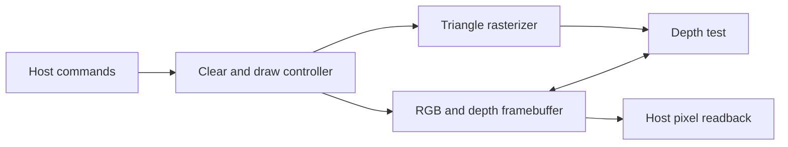

# GPU-Verification-FPGA

Verify a triangle rasterizer, the stage of a GPU that turns a screen-space
triangle into covered pixels. The project includes a small SystemVerilog DUT, a
Python oracle, and a self-checking SystemVerilog testbench. It runs in simulation
without an FPGA board or vendor IP. The renderer adds a host command stream
and a depth-tested RGB framebuffer around the same rasterizer.

## Run

Requires Python 3, Make, and Icarus Verilog (`iverilog` and `vvp`). On macOS,
install Icarus with `brew install icarus-verilog`. See the
[Homebrew formula](https://formulae.brew.sh/formula/icarus-verilog) and the
[Icarus simulator guide](https://steveicarus.github.io/iverilog/usage/index.html).

```sh
make test
make regression
make test-renderer
make render
make test SEED=2027 RANDOM_COUNT=500 WAVES=1
```

- `make test` uses a 32×24 viewport, 24 directed triangles and 200 seeded
  random triangles, plus a reset-abort scenario.
- `make regression` runs two default-size seeds and exercises 1×1 and 128×128
  viewports, then checks the renderer at 32×24, 9×7 and 1×1. Set `WIDTH` and `HEIGHT` on `make test` to try another size.
- `make vectors` checks the Python oracle against hand-derived cases and
  generates expected fragments without an HDL simulator.
- `WAVES=1` writes `build/<WIDTH>x<HEIGHT>/rasterizer.vcd` for waveform debugging.
  Each run overwrites that viewport's vector file and, if enabled, waveform.

## Rasterizer interface

| Signal | Contract |
| --- | --- |
| `tri_valid`, `tri_ready` | A rising edge with both high captures the six signed 8-bit vertex coordinates. One triangle can be in flight. |
| `frag_valid`, `frag_ready` | A rising edge with both high transfers one fragment. The DUT holds valid and coordinates stable during a stall. |
| `frag_x`, `frag_y` | Unsigned pixel indices. Transfers arrive left to right, then top to bottom. |
| `tri_done` | A one-cycle pulse after scanning and transferring all covered pixels. Empty and degenerate triangles also complete. A new command can be accepted in the following cycle. |
| `rst` | Active high. A rising edge with reset high clears pending work. Interface control outputs are suppressed while reset is high. |

Screen-space X increases rightward and Y increases downward. Vertices are
integer coordinates in −128 through 127. The viewport origin is (0,0), its
dimensions are each in 1 through 128, and a sample is at
`(frag_x + 0.5, frag_y + 0.5)`. At dimension 128 the outermost sample on that
axis is 127.5, beyond the maximum vertex coordinate. Both vertex windings are
accepted. The top-left rule assigns samples on shared edges to one triangle.
[Direct3D rasterization rules](https://learn.microsoft.com/en-us/windows/win32/direct3d11/d3d10-graphics-programming-guide-rasterizer-stage-rules)

The DUT scans the viewport and evaluates integer edge functions. The Python
oracle computes exact rational intersections of each sample row with the
triangle and fills the interval from the left intersection, inclusive, to the
right intersection, exclusive. Integer vertex Y values put horizontal edges
between sample rows. The testbench compares every transfer against the oracle
in order, so extra, missing, duplicate, and reordered fragments fail the test.
A failure reports the triangle label and first mismatch.

## Verification matrix

| Scenario | Check |
| --- | --- |
| Two triangles forming a rectangle, using either diagonal | Exact pixel ownership on the shared edge, with no cracks or double hits |
| All six vertex permutations | Identical coverage and output order |
| Clipped and off-screen triangles | Exact in-viewport coverage and empty completion when applicable |
| Collinear, repeated vertices, and subpixel coverage | Completion with zero fragments where no centers are covered |
| Signed coordinate extremes and viewport corners | Correct signed arithmetic, bounds, and end-of-scan behavior |
| Always-ready, alternating, and seeded backpressure | Exact stream and stable output under stalls |
| Reset while a fragment is stalled | Pending fragment and completion are cleared, followed by normal operation |
| Busy and completion checks | No command ready while busy, one completion per command, and bounded completion under the test's ready patterns |

The regression checks that it observed empty and nonempty cases and at least
one stalled cycle. Its scoreboard checks pixel coordinates and ordering. Its
coverage counters describe observed scenarios.

## Render a scene

```sh
make render                               # Render examples/overlap.json
make render SCENE=path/to/scene.json        # Render a custom scene
make render WAVES=1                       # Also write renderer.vcd
```

The testbench checks every RGB and depth value against Python and writes the
simulated hardware's RGB readback to `build/<WIDTH>x<HEIGHT>/frame.ppm`.
A scene is a JSON array beginning with a clear command. Each command takes a
six-digit RGB hex string and an unsigned depth from 0 to 65535. Draw commands
also take three signed 8-bit screen-space vertices as `[x,y]` pairs.
See [the overlap scene](examples/overlap.json) for a complete input.

## Renderer interface



| Signal | Contract |
| --- | --- |
| `cmd_valid`, `cmd_ready` | Both high at a rising edge accept one command. `cmd_draw=0` clears every pixel to the supplied RGB and depth. `cmd_draw=1` draws one flat-color, flat-depth triangle using the supplied vertices. |
| `cmd_done` | A one-cycle pulse after the last write, including when a triangle produces zero writes. The next command can be accepted in the following cycle. |
| `read_valid`, `read_ready` | Both high at a rising edge accept the pixel coordinate. Commands have priority. Reads can stream one per cycle while idle. |
| `pixel_valid`, `pixel_color`, `pixel_depth` | Registered response available after the accepting edge. Out-of-range coordinates return zero RGB and zero depth. The receiver samples each valid response without backpressure. |
| `rst` | A rising edge with reset high aborts pending work. Issue a clear after reset to initialize the framebuffer before drawing or reading. |

Smaller unsigned depths win. Equal depths preserve the stored pixel, so the
first draw wins a tie. A clear at depth 65535 accepts draws with depths
0 through 65534. Color and depth share one memory entry. A fragment fetches
the old entry in one cycle and conditionally writes the new one in the next.

`make test-renderer` checks draw order, depth ties, zero and maximum depths,
clear after drawing, mixed clipped and degenerate geometry, command/read
arbitration, out-of-range reads, and reset during a pending draw. Its
framebuffer scoreboard compares both depth and color at every pixel.

## Project direction

The [reference GPU](https://github.com/karim4353/gpu-fpga/tree/89007c5) organizes
a VHDL design around a programmable SIMD pipeline, a memory hierarchy and
an AXI host interface. It includes host programs that submit work and read
back results. This project follows the same submission and readback workflow
with a two-command SystemVerilog raster pipeline and a pixel-by-pixel
simulation scoreboard.

Two follow-on milestones fit the current command interface:

1. **Textured triangles.** Add texture coordinates, a small texture ROM and
   nearest-neighbor sampling. Use a checkerboard scene and compare RGB and
   depth against the reference model.
2. **FPGA implementation.** Use clipped bounds and incremental edge updates
   to reduce raster cycles. Reuse the framebuffer scoreboard as an
   equivalence check, then measure BRAM/DSP usage and post-route clock
   frequency on the selected FPGA.
